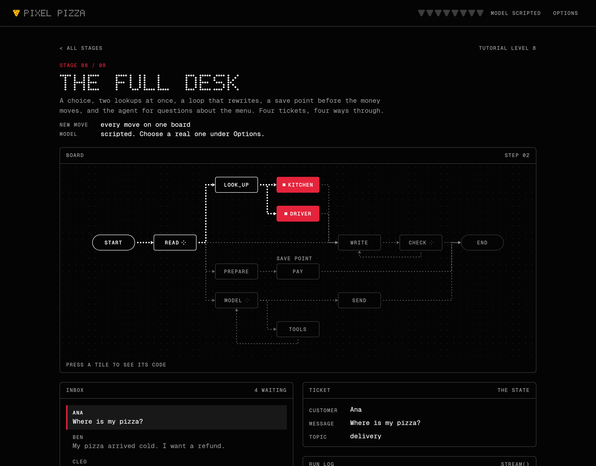
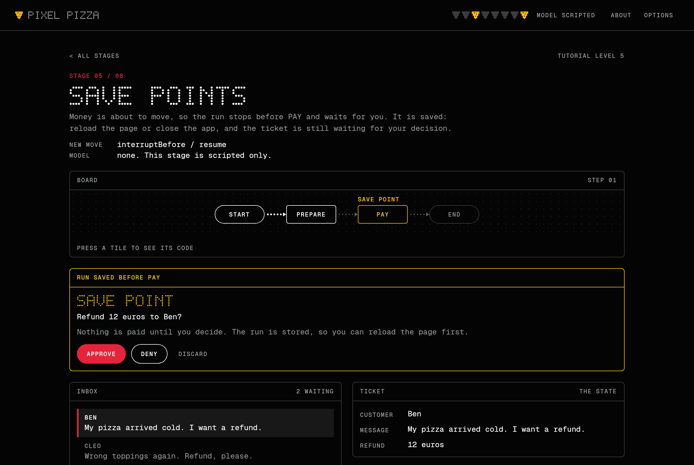
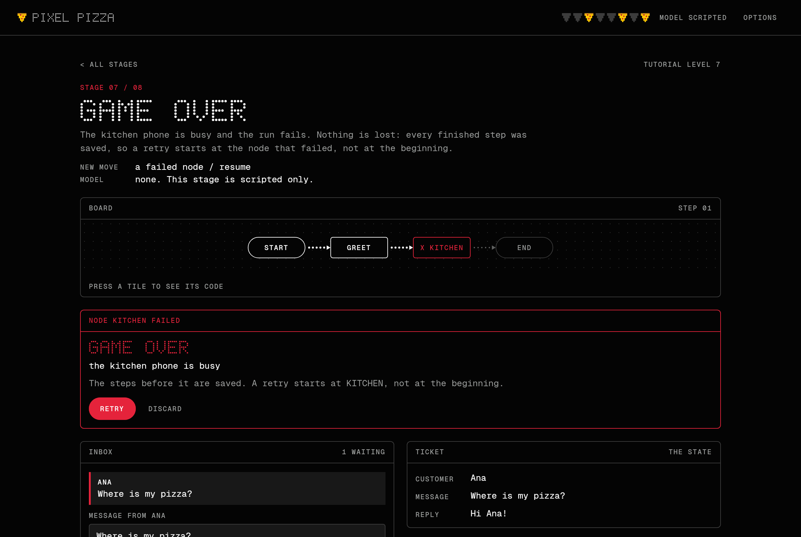
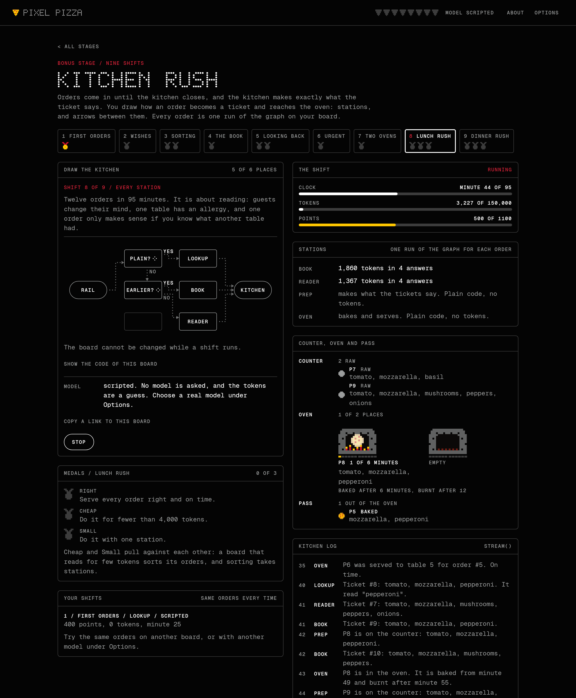

# Pixel Pizza

A small game about graphs. You run the help desk of a pizza shop: customers write in, a
[Telar](https://github.com/deeptelar/telar) graph writes back, and you watch
the ticket cross the board node by node.

**[Play it in your browser](https://deeptelar.github.io/telar-demo/)**



It is the [Telar tutorial](https://github.com/deeptelar/telar/tree/main/docs/tutorial)
made playable. Eight stages, one new move each, the same Pixel Pizza help desk growing from two
nodes to a full agent workflow. One Compose Multiplatform codebase runs it in the browser
(Kotlin/Wasm), on the desktop (JVM) and on Android. No account and no API key needed.

## Stages

| # | Stage | The move |
|---|---|---|
| 1 | A line | Two nodes in a row: `node`, `then`, `invoke` |
| 2 | Choices | `conditionalEdge` picks one of three paths |
| 3 | Loops | An edge that goes back until the reply passes a check |
| 4 | Two at once | Fan-out to nodes with a `work` and an `update`, which run at the same time |
| 5 | Save points | `interruptBefore` stops the run for you; `resume` continues it, also after a reload |
| 6 | The agent | A model that calls tools, as a loop of two nodes |
| 7 | Game over | A node fails; `resume` retries from the last save |
| 8 | The full desk | All of it on one board: four kinds of ticket, four ways through |

Each stage is the level of the tutorial with the same number: stage 3 is level 3.

Watching a run with `stream()`, the second half of level 4, is not only in stage 4. It is the game:
the board, the ticket panel and the run log are drawn from the events of `stream()` as they arrive.
Under each step, the run log lists what the step wrote into the ticket (`topic = "delivery"`,
`facts += "..."`), and after a conditional edge it says which node the edge picked. In the stages
that ask a model, the log shows the answer word by word while the model writes it.

Press a tile on the board to see the code behind it: the node, its arrows and the functions it calls.
The text is cut out of the game's own source files when the app is built, so it is always the code
that runs.

| | |
|---|---|
|  |  |

## Bonus stage: Kitchen rush



A puzzle. A pizzeria works through a shift, and the kitchen makes exactly what a ticket says. You
draw how an order becomes a ticket and reaches the oven: stations on a board with six places, and
arrows between them.

There are nine shifts. The first seven are short, four to eight orders each, and each brings one
station that the shifts before it did not have and that it cannot be won without. The last two are
the rushes, with every station on offer. No shift is locked, and the board stays when you move on,
so a shift starts with the board that won the one before.

| Shift | New station | What it is about |
|---|---|---|
| 1. First orders | Menu lookup | Four pizzas from the menu. Placing a station and drawing its arrows. |
| 2. Wishes | Reader | Guests want a pizza changed, which the lookup does not read. |
| 3. Sorting | Sorter: only a menu pizza? | Most orders need no model. The first medal for few tokens. |
| 4. The book | Reader with the book | Orders that only make sense with what was said before. |
| 5. Looking back | Sorter: about something earlier? | The book costs more with every order, so only the orders that need it go there. |
| 6. Urgent | Expediter | Orders that are not due in the order they come. |
| 7. Two ovens | Second oven | More pizzas at once than one oven can bake in time. |
| 8. Lunch rush | | Twelve orders, about reading. Guests change their mind, one table has an allergy, and one order only makes sense if you know what another table had. |
| 9. Dinner rush | | Twelve orders in two waves, about the oven. One oven that takes the tickets as they arrive is too slow. |

| Station | What it does | What it costs |
|---|---|---|
| Menu lookup | Plain code. Finds the name of a menu pizza in the order and writes that pizza down. | Nothing |
| Sorter: only a menu pizza? | Plain code. Sends an order one of two ways. | Nothing |
| Sorter: about something earlier? | Plain code. Yes when the order names a table, or says "same", "another" or "again". | Nothing |
| Reader | A model reads the order, and only the order. | Tokens, and a minute for each order |
| Reader with the book | A model reads the order with everything the guests said before. | More tokens with every order |
| Expediter | Plain code. Writes on the ticket when the order is due, and the kitchen takes those tickets first, the one that is due soonest before the others. | A place on the board |
| Second oven | Two more places and a chef of its own, for the pizzas of the orders that pass it. | A place on the board |

The board is a Telar graph, and the game shows its code: a node for each station, an edge for each
arrow, a conditional edge for each sorter. Every order is one run of that graph, from the rail
(`START`) to the kitchen (`END`). A board that cannot run says why before the shift starts, and
what the game does not check itself is reported by Telar when the graph is compiled.

The orders of a shift are the same every time, and they are listed before it starts, with what
the guests say later. Under each order is the way it takes across the board as you have drawn it.
Only the sorters decide that way, and they are plain code, so the game knows it without asking a
model.

After a shift every order shows the way it took and the ticket it got, so you can see which
station failed it. While the shift runs, the oven shows its places in pixels: a fire under each
pizza, and a bar that fills until the pizza is baked, and then until it is burnt.

Every shift has a medal for serving every order right and on time. Shifts 3 and 5 have a second
one for few tokens, and each rush has three, which no board wins together:

| Medal | What it takes | Lunch rush | Dinner rush |
|---|---|---|---|
| Right | Every order right and on time | 1100 points | 1200 points |
| Cheap | That, for few tokens | Fewer than 4,000 | Fewer than 4,000 |
| Small | That, on few stations | One station | Three stations or fewer |

Cheap and Small pull against each other. One reader with the book reads every order right, which
is the small board, and it pays for the whole book every time. The cheap board sorts its orders, so
that a model reads only the ones that need it, and sorting takes stations. In the dinner rush the
six places are the puzzle as well: every order on time needs the expediter and the second oven, and
the sorters have to fit in what is left. The panel of the medals shows your best for each, and the
shifts you played are listed side by side. The medals you won are kept between sessions, with the
cleared stages.

A board fits in a link. "Copy a link to this board" gives an address that opens the stage with that
shift chosen and that board drawn, and after a shift the result can be copied with it, to post:

```
Pixel Pizza, dinner rush: 1200 of 1200 points for 3,564 tokens on 5 stations. Can you beat this board?
https://deeptelar.github.io/telar-demo/#kitchen=dinner.plxbo-413k0k2
```

Without a key the readers are scripted: the one with the book is always right, and the one without
it cannot know what it was not told. Their token counts are a guess from the length of the text,
the same every time, and the medal for few tokens is set for them. With a real model under
Options every reader asks that model, the tokens are the ones the service reports, and the shift
stops at a token budget.

The kitchen behind the board is the [kitchen sample](https://deeptelar.github.io/telar/samples.html)
of Telar, copied into `kitchen/`. The board is not part of the sample.

## Play

The browser version is at <https://deeptelar.github.io/telar-demo/>. Every push to
`main` publishes it there.

To run it from a clone of this repository:

```bash
./gradlew :composeApp:wasmJsBrowserDevelopmentRun   # browser, with a dev server
./gradlew :composeApp:run                           # desktop
./gradlew :androidApp:installDebug                  # Android, on a connected device or emulator
```

Requires JDK 17 or newer. The Android app also needs the Android SDK with platform 37: set
`ANDROID_HOME`, or put `sdk.dir=/path/to/Android/Sdk` in a `local.properties` file in this
directory. It runs on Android 7 and newer.

Stages 6 and 8 ask a model, and their cards say so: "scripted or a model". The other stages are
"scripted only". By default the model is a scripted one with fixed answers. To play the two stages
with a real model, pick a service under Options and enter your own key for it:

| Service | What you enter |
|---|---|
| Claude | Your Anthropic API key, and one of the models on the list. They are listed from the cheapest to the most expensive, with their prices. |
| OpenAI | Your OpenAI API key. The model is `gpt-5` unless you name another. |
| Gemini | Your Gemini API key. The model is `gemini-3.8-flash` unless you name another. |
| Other address | The address of any other server with the API of OpenAI, a model, and a key if the server asks for one. It starts with the address of an Ollama on your device. |

The model has to be one that can call tools. The key goes straight from the app to the service and
nowhere else, and it is kept in memory unless you tick "Remember the key on this device". Requests
are billed to your account.

In the browser the game calls the service from the page, so the service has to accept that.
Anthropic, OpenAI, Google, Groq, Mistral and OpenRouter do. An Ollama on your device only answers
the page when it was started with `OLLAMA_ORIGINS=https://deeptelar.github.io`. The desktop
and the Android app have no such limit.

## How it works

- **A stage is a graph and a map.** [`game/HelpDesks.kt`](composeApp/src/commonMain/kotlin/dev/deeptelar/telar/demo/game/HelpDesks.kt)
  and [`game/Agent.kt`](composeApp/src/commonMain/kotlin/dev/deeptelar/telar/demo/game/Agent.kt) hold
  the eight graphs. [`game/Stages.kt`](composeApp/src/commonMain/kotlin/dev/deeptelar/telar/demo/game/Stages.kt)
  gives each one its briefing, its inbox, and the cell of every node on the board.
- **The board draws the graph it is given.** Tiles sit where the stage puts them. The arrows are
  read from `CompiledGraph.topology`, and they light up from the `NodeStarted`, `NodeCompleted` and
  `StepCompleted` events of the run.
- **A save point is a checkpoint.** Runs are saved by the library's checkpointers:
  `LocalStorageCheckpointer` in the browser, `FileCheckpointer` on the desktop and on Android. That
  is why a ticket waiting for your decision survives a reload, and why a failed run can be retried
  from the node that failed.
- **The look is drawn, not themed.** Black, white, a ramp of greys and one red, after
  [nothing.tech](https://nothing.tech). The headings are a 5 by 7 dot-matrix alphabet in
  [`ui/DotMatrix.kt`](composeApp/src/commonMain/kotlin/dev/deeptelar/telar/demo/ui/DotMatrix.kt), the
  pizza is text in [`ui/Sprites.kt`](composeApp/src/commonMain/kotlin/dev/deeptelar/telar/demo/ui/Sprites.kt),
  and the rest is Geist Mono. There is no Material in the app.

## Layout

- `game/`: the ticket (the state), the graphs of the stages, the tools of the agent
- `kitchen/`: the bonus stage: the kitchen as plain code and the fixed shift, from Telar's sample.
  `Blueprint.kt` is the board a player draws, `BoardShift.kt` turns it into the graph that runs a
  shift, `Lessons.kt` has the seven short shifts and `DinnerRush.kt` the second rush, and
  `BoardText.kt` writes a board as the short text that a link carries
- `llm/`: the scripted model, and the Claude models on offer. The chat model interface, the agent
  loop and the clients come from `telar-agent`, `telar-anthropic` and `telar-openai`. Which service
  answers is decided in `ui/Settings.kt`
- `storage/`: which checkpointer of the library each platform uses, and `KeyValueStore` for the
  settings and the cleared stages
- `ui/`: the screens, the board, `Game.kt`, which runs the graphs of the stages for them, and
  `KitchenController.kt`, which holds the board of the bonus stage and runs a shift on it.
  `KitchenBoard.kt` draws that board, and `KitchenLink.kt` is the link to one

## Tests

```bash
./gradlew :composeApp:jvmTest             # everything, on the JVM
./gradlew :composeApp:wasmJsBrowserTest   # the common tests again in headless Chrome (needs Chrome)
```

Every pull request runs both, and the game is only published when they pass.

The JVM run also clicks through the game the way a player would, and draws every screen to
`composeApp/build/screenshots`. A pull request has those pictures as the artifact `screenshots` of
its test run. The pictures in this README come from there. So does
`social-preview.png`, the picture a link to the game or to this repository is shown with: copy it
to `composeApp/src/wasmJsMain/resources/` after a change, and upload the same file under Settings,
Social preview.

Building this app is a test of Telar from outside its repository. What that turned up is in
[FINDINGS.md](FINDINGS.md).

## License

[Apache License 2.0](LICENSE). Geist Mono is bundled under the
[SIL Open Font License](licenses/GeistMono-OFL.txt).
